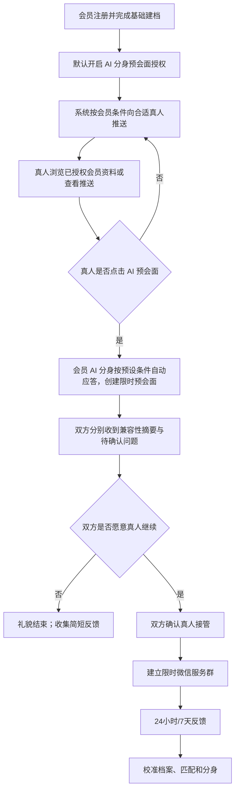

# AI 红娘 MVP 产品设计

## 账户身份与会员能力

所有人以同一种“注册用户”身份进入产品，先建立档案、浏览推荐并被推荐；不在注册时选择“会员”或“候选真人”。付费后账户获得会员能力：创建 AI 数字分身、开启 AI 预会面授权、设置分身表达边界和优先议题。“候选真人”仅描述一场预会面中与会员分身交流的一方，不是长期账户身份。

未接支付前，会员能力只通过本地开发测试身份验证；正式版本应由支付成功事件开通，并处理到期、退款和人工调整。

版本：v0.1  
日期：2026-10-21  
产品定位：面向认真寻找长期关系的成年人，用“会员授权的 AI 分身预会面”减少无效沟通，再将双方愿意继续了解的对象牵线给真人。

## 1. 产品判断

现有婚恋产品常在“推荐对象—双方等待—直接建群/私聊”之间流失：用户需要自行核对硬条件、反复破冰，也难以判断对方是否具备继续交流的意愿。

本产品不承诺由 AI 替用户恋爱或判断“谁最适合谁”。AI 的职责是代表已授权的会员完成一次短时、受约束的预会面：确认核心条件、暴露待沟通的问题、总结可继续了解的原因。只有双方确认后，会员本人进入真人交流。

**北极星价值**：把会员的时间留给高意愿且关键条件可沟通的人。

## 2. 从 AI 小真获得的借鉴与边界

本次已授权的静态与受控运行时观察显示，AI 小真包含资料/认证、推荐与精准匹配、匹配历史、会员权益、建群次数与群聊卡等模块。其已验证的运行时只读接口包括匹配历史、会员状态和个人资料；未测试也不据此推断其服务端 AI 排序逻辑或付费写入流程。

本 MVP 借鉴其“资料—匹配—牵线—会员”的闭环，但不复制页面、实现、协议、数据或商业规则。差异是：

- 不以“建群次数”作为主要售卖对象，而以 AI 预会面和高质量真人牵线作为会员价值；
- 不让两个 AI 直接替双方谈恋爱；
- 对方真人始终明确知道自己在与“会员授权的 AI 分身”交流；
- 群聊/私聊发生在双方确认继续了解之后。

## 3. MVP 假设与验证目标

### 核心假设

1. 候选真人愿意在充分告知后，与会员授权的 AI 分身进行 10–15 分钟预会面。
2. 结构化档案、情境选择和会员校准，足以让 AI 对常见相亲问题做出可信且不越权的回应。
3. 预会面可以提高双方愿意开始真人聊天的比例，并降低真人聊天后的快速流失。
4. 会员愿意为节省筛选时间、优先预会面和真人牵线建议付费。

### MVP 成功标准

- 已完成预会面的配对中，双方确认“愿意真人继续”的比例高于直接推荐后的直接牵线基线。
- 真人接管后 24 小时仍持续交流的比例高于基线。
- 会员对 AI 回答的“准确”确认率达到可用水平，且人工改写率随使用次数下降。
- 没有发生 AI 冒充真人、未经授权披露敏感资料或未授权牵线的重大信任事件。

## 4. 用户与角色

| 角色 | 身份 | 主要目标 | MVP 权限 |
|---|---|---|---|
| 免费用户 | 候选真人 | 找到合适对象，低成本判断是否值得继续了解 | 建档、获得推荐、同意/拒绝预会面、查看自身摘要、同意真人牵线 |
| 会员 | 已开通会员的真人 | 减少低效破冰，优先获得高意愿真人机会 | 完整建档、创建/校准 AI 分身、默认开启或随时关闭预会面授权、查看经授权的摘要、真人接管 |
| AI 红娘 | 系统代理 | 促成清晰、安全的早期相亲沟通 | 仅在会员权限范围内回应、提问、总结和提醒 |
| 运营审核员 | 平台人员 | 处理认证、举报、异常与人工兜底 | 不参与正常私密对话；只在规则触发或双方授权的范围处理 |

## 5. 核心用户流程

### 关键承诺文案

候选真人进入前必须看到：

> 你将与该会员授权的 AI 分身进行一次约 10 分钟的预会面。该分身已按会员设置的匹配条件接受本次交流；AI 只依据会员确认过的资料回答。涉及承诺、关键隐私和联系方式的问题，将由会员本人回答。双方都愿意继续后，会员本人才能进入交流。

## 6. MVP 功能范围

### 6.1 基础建档（所有用户）

目标：3 分钟内形成能用于初筛的档案。

- 手机号注册、成年人确认、基础真实性校验；
- 基本资料：年龄、性别、城市、身高、学历、职业状态、婚姻/子女状态；
- 相亲目标：恋爱/长期关系/结婚意向；
- 硬约束：年龄范围、城市或异地、婚育意向等；
- 每项均允许“暂不确定”或“真人再谈”；
- 用户可查看、修改和删除自己的档案。

### 6.2 会员 AI 红娘建档

目标：用选择题建立“相亲决策档案”，而不是一次性长问卷。

**题型比例**：约 70% 单选/多选/排序/滑杆，20% 情境选择，10% 可跳过的短补充。

分三阶段完成：

1. **会员开通时，8–10 分钟、20–25 题**：关系节奏、城市与工作、家庭边界、消费与责任、婚育、沟通方式、冲突处理、个人空间。
2. **AI 自动总结确认**：会员对每条点击“准确 / 修改 / 不允许对外表达”。
3. **持续微校准**：每次预会面或真人聊天后，仅补充 1–2 个反馈题，例如“AI 哪句话不准确”“本次犹豫的主要原因”。

### 6.3 分身代理权限

会员为每类资料设置代理权限：

| 信息类型 | 默认规则 |
|---|---|
| 兴趣、生活方式、关系目标、沟通偏好 | 可由 AI 概括回答 |
| 城市、职业、婚恋计划 | 可答，但标记为会员确认信息 |
| 收入、资产、健康、婚史细节、家庭隐私 | 默认“需要本人确认” |
| 联系方式、原始照片、线下地点 | 不可披露 |
| 见面承诺、排他承诺、支付或借款 | 不可代答，必须真人接管 |

每一条 AI 回答必须被归为：**会员已确认**、**倾向性理解，需本人确认**、或**必须真人回答**。系统不得把推断包装为事实。

### 6.4 匹配与预会面发起

- 系统先按硬约束排除不合格对象；
- 向双方展示不含敏感信息的基础匹配理由；
- 会员完成建档后，AI 分身预会面授权默认开启，并在资料页明确展示开关；会员可随时关闭、调整条件或设置可同时进行的房间数量；
- 开启授权的会员资料进入可推荐池。系统按会员条件筛选后向合适的候选真人推送；
- 候选真人也可主动浏览已授权 AI 预会面的会员公开资料；
- 候选真人从推送或浏览页点击“申请 AI 预会面”，即完成本次预会面的人工同意，会员 AI 分身自动应答并创建房间；
- 不等待会员本人对每位候选人逐次确认。
- 候选真人可选 1–3 个最想了解的话题；
- 会员可设置本周可发起预会面的数量；
- 未经双方再次确认，不交换联系方式，不建真人群。

### 6.5 AI 预会面房间

这是平台内的临时会话，不是微信真人群。

- 时长：从预会面开始起最多 24 小时；
- 轮数：默认最多 20 轮；
- 节奏：AI 开场说明身份与边界，候选真人自由提问，AI 在必要时引导至待确认议题；
- 内容：重点讨论相处方式和现实安排，不做泛泛陪聊；
- 防越权：敏感问题自动转为“建议由会员本人确认”；
- 候选真人可随时结束、举报或选择“不愿共享完整提问内容”；
- AI 不生成暧昧承诺、不进行金钱往来、不引导站外交易。

### 6.6 预会面结果与真人接管

会话结束后，双方各自得到一张决策卡，而不是默认共享原始全文。

| 模块 | 内容 |
|---|---|
| AI 红娘观察 | 基于本轮互动与双方已授权资料，说明已呈现的关注点与互动质量 |
| 值得继续了解 | 提供可自然延展的连接点，不输出匹配分、成功概率或人格诊断 |
| 真人阶段建议 | 提供一个低压力、可执行的下一步话题或交流方式 |
| 双方独立意愿 | 各自选择是否愿意真人继续，未同意前不开放真人入口 |

分身无法确定、需要会员本人补充的回答，不展示给候选真人；仅作为会员本人的私密校准提醒，在后续由本人查看和确认。双方都点击“愿意继续”后，系统创建一间限时微信服务群，作为真人接管的统一入口。

服务群包含两位真人和清晰标识的 AI 红娘服务能力。双方可在群内交流，也可自行转为微信私聊；AI 不冒充任何一方，不主动高频插话，只在被 @、用户主动点击服务入口、需要约见建议/关系复盘，或投诉与安全协助时响应。人工红娘接管须由用户主动申请或在已告知的风险处置流程中介入。

服务群默认保留 7 天：到期前提醒双方，7 天后停止 AI 红娘服务和人工红娘常规跟进，并按平台能力执行归档或解散。群内两位真人是否继续私聊由双方自行决定。任一方可退出、举报或关闭 AI 服务；群内内容仅在双方已知的服务范围内处理，不读取双方私聊内容。

### 6.7 反馈闭环

- 真人接管后 24 小时：是否愿意继续；
- 7 天后：是否持续交流、主要阻碍；
- 会员校准：AI 回答准确/不准确、应该如何改写；
- 候选人反馈：预会面是否清楚、是否感到被误导、是否愿意再次使用；
- 只把用户明确授权的反馈写回其档案；不将对方私密内容直接写入会员分身。

## 7. 匹配与分身策略

### 匹配策略

MVP 不追求“恋爱成功概率黑箱分数”，采用可解释的三层筛选：

1. **硬约束层**：性别取向、年龄、地域、婚育、关系目标及用户明确排除项；
2. **兼容主题层**：生活节奏、家庭边界、沟通与冲突、城市与事业、财务观；
3. **探索价值层**：存在可讨论但非绝对冲突的差异，适合通过预会面验证。

对外只展示“为什么值得聊”和“需要确认什么”，而不展示无解释的分数排名。

### 分身策略

分身是受约束代理，不是独立人格：

- 检索来源仅限会员确认的档案、代理权限和会员主动校准内容；
- 每次回复先判断信息级别，再选择回答、澄清或请求真人接管；
- 采用预设主题和轮次预算，避免无目的长聊；
- 对自伤、暴力、诈骗、色情交易、歧视、金钱往来等风险内容触发安全策略与人工处理流程；
- 对用户做出的“AI 不应代答”标记即时生效。

## 8. 会员与商业模式

### MVP 定价逻辑

免费用户获得基础建档、有限推荐和被邀请参与预会面。会员购买的是时间效率与更高质量的牵线，而不是购买他人注意力。

| 权益 | 免费用户 | 会员 |
|---|---|---|
| 基础建档与被推荐 | 有 | 有 |
| AI 红娘档案 | 基础版 | 完整版与持续校准 |
| 发起 AI 预会面 | 受限或不可发起 | 每月配额 |
| 预会面结果卡 | 自己的摘要 | 自己的摘要、真人接管建议 |
| 真人牵线 | 双方同意后可进入 | 优先获得与管理预会面机会 |
| 人工红娘 | 无 | 后续高阶增值服务 |

早期应通过小规模实验验证“月度会员”与“预会面配额包”何者更能表达价值；不建议在 MVP 过早引入复杂的群聊卡、道具和多档付费套餐。

## 9. 数据、信任与合规设计

婚恋信息通常属于高敏感个人信息。MVP 从产品设计层面执行以下原则：

- 分离同意：匹配、预会面、档案持续学习、模型改进分别取得清晰授权；
- 最小化：只收集实现匹配和已授权代理所必需的数据；
- 可见可控：用户可查看、纠正、删除档案字段和标签，关闭个性化匹配；
- AI 标识：每次预会面清晰提示对方正在与 AI 分身交流；
- 默认最少披露：默认不展示联系方式、精确位置、收入资产、家庭隐私和原始聊天全文；
- 认证与举报：身份、照片、学历等认证应与展示范围分离；建立举报、拉黑、异常检测和人工处置；
- 内容治理：保留必要安全日志，设置数据保留期限和删除机制；
- 上线前完成隐私政策、用户协议、算法/生成式 AI 义务评估与专业法律审查。

算法推荐服务需提供相应的知情、关闭个性化服务与用户标签管理能力；生成式 AI、深度合成等服务还涉及内容、安全和可能的备案/评估义务。具体义务取决于上线形态和规模，应由专业合规律师结合实际业务确认。

## 10. 技术实现边界

### MVP 系统组件

- 小程序或移动 Web：注册、建档、推荐、预会面、结果卡、反馈；
- 用户与档案服务：结构化资料、权限、版本与删除；
- 匹配服务：规则筛选、候选生成、解释生成；
- AI 编排服务：资料检索、权限判断、主题控制、输出审核、会话总结；
- 安全服务：内容审核、风控、审计、举报工单；
- 运营后台：认证审核、异常会话、人工红娘、指标看板。

### 不在 MVP 范围

- AI 自主代替真人长期恋爱；
- 语音/视频数字人；
- 未经双方确认建立微信群、自动邀请第三方；
- 支付、借贷、礼物或站外交易引导；
- 复杂的匹配模型训练和“成功率预测”；
- 未经明确授权使用私密聊天内容训练通用模型。

## 11. 核心指标与实验设计

### 漏斗指标

1. 注册 → 完成基础建档；
2. 会员 → 完成 AI 红娘建档；
3. 推荐曝光 → 双方同意预会面；
4. 预会面开始 → 完成；
5. 完成预会面 → 双方愿意真人继续；
6. 真人接管 → 24 小时持续聊天；
7. 7 天持续交流 / 愿意见面；
8. 会员开通、续费、投诉和举报率。

### 分身质量指标

- 会员确认 AI 回答“准确”的比例；
- 会员改写/禁止代答的比例；
- 真人接管后“AI 描述与本人差异很大”的反馈率；
- AI 建议继续后双方仍愿意真人继续的比例；
- 对不同性别、年龄、地区、关系目标的人群公平性差异。

### 早期实验

- 对照组：仅展示基础匹配理由，直接邀请真人聊天；
- 实验组：先进行 AI 预会面，再由双方确认真人接管；
- 不以 AI 聊天轮数作为成功指标，以“双向真人继续率”和“后续持续交流率”为主。

## 12. 分阶段交付

### 阶段 1：封闭验证

招募少量、已身份核验的种子用户。完成基础建档、会员 AI 红娘建档、规则匹配、文本预会面、决策卡和人工客服兜底。人工审核匹配结果与异常会话。

### 阶段 2：小规模付费试验

上线有限会员配额，测试定价、完成率、真人接管率和投诉率。在微信能力、账号体系和合规路径明确后，试点双方同意后建立的 7 天微信服务群。

### 阶段 3：运营与渠道扩展

在合规审查和平台能力确认后，接入更多认证、人工红娘服务和受双方确认约束的微信牵线能力。

## 13. 当前需要验证的产品决策

1. 候选真人是否愿意与明确标识的会员 AI 分身预会面；
2. 24 小时 / 20 轮是否足以产生可用的真人接管判断；
3. 预会面结果应只给摘要，还是允许双方自愿共享部分原文；
4. 会员权益采用月度配额、单次服务，还是二者组合；
5. 7 天微信服务群中，AI 红娘的主动程度、人工接管触发条件与到期后的归档/解散体验；
6. 哪些资料必须先认证，哪些仅可作为用户自述展示；
7. 在不读取对方私密信息的前提下，如何将反馈有效写回会员的相亲决策档案。

## 14. 档案采集与可信度设计（v0.2）

### 14.1 可借鉴的采集结构

参考已提供的 AI 小真界面，资料页采用“基础资料—补充资料—交友偏好”三段式，并将少量硬条件单独标为优先项。这种结构适合婚恋场景，MVP 可以保留其信息架构，但不复制具体界面或文案。

本产品新增第四部分“AI 红娘档案”，用于形成会员的代理规则和相处偏好。四部分的职责必须分开：

| 模块 | 用户填写内容 | 用途 | 对外默认可见性 |
|---|---|---|---|
| 基础资料 | 基本身份、城市、身高、学历、婚育、首张照片 | 身份可信度与硬条件筛选 | 经匹配后展示摘要 |
| 补充资料 | 职业、收入区间、居住与通勤、兴趣、生活状态、自我介绍、相册 | 补足现实生活信息 | 用户逐项选择展示范围 |
| 交友偏好 | 对方的范围和条件、异地、婚育、生活安排 | 候选筛选 | 仅自己、AI 和匹配系统可见 |
| AI 红娘档案 | 情境选择、价值排序、沟通方式、不能代答项、校准反馈 | AI 预会面与真人接管建议 | 仅本人、AI；只按权限对外表达 |

### 14.2 MVP 必填项与渐进补充

避免在首次进入时收集收入、家庭资产、恋爱次数等所有敏感字段。用户先完成最小档案，之后在获得明确收益时再补充。

**首次建档（约 3 分钟，完成匹配所需）**

- 成年人确认、手机号；
- 性别/性别取向、出生年月、现居城市、身高；
- 学历、职业大类、婚姻与子女状态；
- 关系目标、异地接受度、年龄范围；
- 至少一张本人照片或后续完成照片核验的引导。

**补充资料（可延后，提升候选质量）**

- 收入采用区间，不要求具体数额；
- 住房、车辆、家庭资产先按“自述”展示，不在 MVP 承诺验证；
- 工作节奏、居住安排、兴趣、生活照片、简短自我介绍；
- 婚恋目标、是否希望有孩子；
- 恋爱次数、家乡、独生子女等仅作为可选信息，不能默认成为硬性淘汰条件。

**交友偏好（私密）**

- 条件分为“必须满足”“优先考虑”“可以聊聊”三类；
- 最多选择 3 项“必须满足”，避免把过多偏好误设为硬门槛；
- 年龄、城市、婚育、关系目标、异地等可作为硬约束；
- 收入、学校层级、住房、车辆、家庭资产等默认是偏好，不应自动定义为价值排序；
- 每项提供“不限 / 暂不确定 / 真人再谈”。

### 14.3 档案可信度，不等于公开更多隐私

每一个档案字段要保存并展示其来源状态，而不是一概称为“认证”：

| 状态 | 含义 | 示例展示 |
|---|---|---|
| 已核验 | 由合规服务完成核验，仅保存核验结果或凭据 | 实名已核验、活体/照片一致性已核验 |
| 用户自述 | 用户填写，未由平台核验 | 收入区间、住房、职业描述 |
| 用户确认 | 用户确认允许 AI 对外概括 | 沟通偏好、城市计划、婚恋节奏 |
| AI 理解 | 从用户选择或反馈得出的倾向 | “更偏好冷静后沟通，需本人确认” |
| 不对外披露 | 可用于本人或匹配，不提供给候选人 | 联系方式、精确位置、敏感家庭细节 |

候选人看到的是“实名已核验”“本人照片已核验”等有限标记，而不是身份证号、证件照片、活体影像或人脸特征。

### 14.4 核验优先级

MVP 建议只做两类直接提升信任的核验：

1. **实名核验**：接入合规身份核验服务；平台保存供应商返回的核验状态、时间、服务商流水号或不可逆凭据，而非自行长期保存身份证影像和号码。
2. **本人照片核验**：在用户单独同意后，通过活体检测与当前照片比对确认“当前照片与实名本人一致”；原始活体材料应由服务商按必要期限处理，平台只获得通过/未通过结果。

学历、职业、婚姻状态、房产和收入等全国性核验，先不作为 MVP 能力或对外承诺。后续可针对高阶会员引入用户主动提交材料的人工审核，但必须明确其审核范围与有效期。

人脸、生物识别、身份证件和财产类信息风险更高。实现前应完成供应商尽调、个人信息保护影响评估、单独同意、加密与访问权限设计，并提供撤回同意和删除路径。

### 14.5 相册与资料的展示规则

不以“聊天满 5 轮”自动开放相册。AI 预会面可能让聊天轮数失去意义，且自动解锁会使用户失去控制。

MVP 采用以下规则：

- 首张经用户选择的公开头像可在双方同意预会面前展示；
- 其他相册由用户设置为“匹配后可见”或“双方同意真人接管后可见”；
- 原图、精确位置、带明显住址/工作地点的照片默认不展示；
- AI 分身不得在对话中发送相册、联系方式或外部二维码；
- 任一方取消继续交流后，自动停止新增资料访问。

### 14.6 AI 红娘档案的具体采集题库

在基础、补充与偏好资料完成后，会员进入 8–10 分钟的选择题式 AI 红娘建档：

- 关系节奏：何时考虑稳定关系、对见面频率的期待；
- 城市与事业：是否可能迁居、工作变化如何共同决策；
- 家庭边界：父母参与、节假日安排、独生子女责任；
- 沟通与冲突：当下沟通/冷静再谈/需要空间；
- 消费与责任：共同消费、储蓄、风险偏好；
- 婚育：是否要孩子、时间预期与不可协商项；
- 生活方式：作息、社交、烟酒、运动、宠物；
- 代理权限：可代答、需本人确认、不可对外表达。

每题均提供“视情况而定”“希望真人再聊”和可选补充。完成后系统生成一页可编辑的“AI 对我的理解”，会员逐条确认、改写或禁止对外表达。

### 14.7 MVP 后台审核队列

运营后台仅建设必要队列：

- 身份与照片核验状态、失败重试与人工复核；
- 举报、拉黑、诈骗/金钱往来/冒充风险；
- 高风险敏感内容和异常频率；
- 用户发起的资料删除、授权撤回、档案更正；
- 不建立人工常态查看私密预会面内容的机制。

## 15. AI 红娘服务分层：借鉴“臻选服务”，不替代预会面核心

从所提供的 AI 小真“红娘臻选”页面可见，其对外表达为一项独立服务：按匹配次数收费，围绕需求校准、深度搜索、推送对象、满意后进群、获取反馈和关系推动形成服务流程。页面文案不足以证明其中 AI 与人工各自的实际占比，但可确认其产品定位更接近“高触达撮合服务”。

本产品可以借鉴其服务化包装，但需要与“AI 分身预会面”清楚区分：

| 层级 | AI 小真页面所表达的方向 | 本产品定位 | 适用阶段 |
|---|---|---|---|
| 基础匹配 | 推荐与匹配机会 | 规则匹配、基础候选卡 | 免费用户与会员 |
| AI 红娘预会面 | 页面未显示为核心步骤 | 会员分身与候选真人完成限时、受控预会面 | 本产品 MVP 核心 |
| 臻选撮合服务 | 需求校准、深度搜索、推送、进群、复盘、关系推动 | AI 红娘策划 + 人工运营兜底的高阶服务 | MVP 后的增值服务 |

### 15.1 产品命名与承诺

- **AI 红娘预会面**：标准化会员权益。承诺“减少无效破冰、帮双方形成是否真人继续的判断”，不承诺脱单结果。
- **AI 红娘臻选**：后续高阶服务。承诺“基于更完整档案进行定向筛选、人工复核和关系阶段复盘”，不承诺特定数量或成功率，除非服务能力已验证。

### 15.2 高阶服务的闭环

高阶服务应复用同一份档案、匹配服务和预会面结果，而不是另建一套用户资料：

1. 会员校准目标与不可协商条件；
2. AI 从候选池进行深度筛选，运营人员仅在必要时复核；
3. 候选双方同意后先进入 AI 预会面；
4. 双方愿意继续后真人接管；
5. 收集双方反馈，调整下一轮筛选和会员分身；
6. 关系推进建议只在双方授权下提供。

### 15.3 商业模式建议

MVP 先验证月度会员包含的预会面配额，避免一开始将每一次真人牵线都商品化。通过验证后，再增加“臻选服务包”：定向筛选配额、人工复核、优先运营响应和复盘，而不是出售对方的联系方式或承诺结果。

## 16. AI 匹配可得性诊断：从资料填写到可执行策略

参考所提供的“择偶分析”页面，可将其转化为本产品的前置 AI 能力：用户完成基础资料与偏好后，AI 生成一份**匹配可得性诊断**，帮助用户理解当前条件在“本平台、当前已核验候选池”中的可选范围，并由用户决定是否调整偏好。

### 16.1 不使用“脱单概率”作为 MVP 承诺

“未来一年脱单概率 32%”这类精确数字依赖长期、充分且有代表性的真实结果数据；在早期候选池较小或地域不均衡时，很容易制造不可靠的确定感。因此 MVP 对外采用以下表达：

- 当前可匹配候选池：充足 / 有限 / 很少；
- 主要限制来自哪些用户设定的硬条件；
- 哪些条件属于“必须坚持”，哪些可通过预会面验证；
- 三种由用户选择的匹配策略；
- 每项策略在当前候选池中可能增加或减少的候选范围。

只有当未来积累了足够、经过校验的同类人群长期结果数据，且能展示统计口径和不确定性时，才评估是否展示概率区间；也不把它作为营销承诺。

### 16.2 计算与生成分工

| 环节 | 实现方式 | 约束 |
|---|---|---|
| 候选池规模与筛选影响 | 确定性规则与匿名聚合统计 | 只基于本平台当前可用、已同意被推荐的候选人 |
| 硬条件冲突检查 | 规则引擎 | 不自动改变用户条件 |
| 资料与偏好摘要 | AI | 仅概括用户确认的信息 |
| 方案说明与追问 | AI | 不虚构市场数据，不贬低用户，不替用户做决定 |
| “采用方案” | 用户点击确认 | 记录版本，可撤销、可恢复 |

### 16.3 诊断报告结构

报告使用中性、可行动的语言，避免“竞争优势/竞争劣势”这种把人商品化的表达：

| 报告模块 | 对用户展示 | 数据来源 |
|---|---|---|
| 你的匹配亮点 | 已核验、可公开且用户认可的稳定信息 | 用户确认资料与核验状态 |
| 当前候选池限制 | 哪些组合条件使可选人群减少 | 匿名聚合筛选结果 |
| 待确认而非淘汰项 | 适合交给 AI 预会面讨论的差异 | 用户标记为“可聊”的偏好 |
| 匹配策略方案 | 保守、平衡、探索三种方案 | 规则计算 + AI 解释 |
| 下一步 | 保持条件、调整一项偏好、补充档案或开始预会面 | 用户自主选择 |

“匹配亮点”不将收入、身高、户籍、婚姻状态等描述为人的价值高低；它只说明该用户在特定、已授权展示的偏好组合中，可能增加哪些匹配机会。

### 16.4 三种策略方案示例

- **保守方案**：维持所有“必须满足”条件，只推荐同时满足条件的候选人；
- **平衡方案**：保留婚育、城市、关系目标等核心边界，将一项偏好改为“预会面确认”；
- **探索方案**：仅在用户主动选择时扩大一项非核心范围，例如可迁居意愿或年龄区间，并明确不会改动其底线。

方案必须显示“会改变什么”“不会改变什么”，并提供“不调整，保持当前设置”。用户不采纳建议不会影响正常推荐。

### 16.5 与 AI 分身预会面的连接

诊断把偏好分为“淘汰条件”与“预会面议题”后，直接生成分身的会话优先级。例如，用户对异地不是绝对拒绝而是担心迁居安排，AI 预会面应提问双方的城市计划，而非在推荐前直接排除。

这使该功能成为数字分身的有效数据入口，而非单独的报告页：

`资料与偏好 → 匹配可得性诊断 → 用户确认策略 → 候选筛选 → AI 预会面议题 → 真人接管反馈 → 更新下一版诊断`

## 17. 候选信息展示与 AI 预会面入口

可借鉴“精选候选卡”的信息密度：一张卡说明对方的基础摘要、已核验标记、关键匹配理由、相册状态和下一步动作。MVP 不复制其具体视觉、名称、分数或“建群聊天”机制，而是以用户可控的分级披露和 AI 预会面作为入口。

### 17.1 候选卡信息层级

| 层级 | 展示内容 | 触发条件 |
|---|---|---|
| 推荐前 | 昵称、年龄段、城市级别、公开头像策略、关系目标、已核验标记 | 用户进入候选列表 |
| 双方同意预会面后 | 3 个公开标签、3–5 条匹配理由、可讨论的差异、受限相册 | 双方明确同意 |
| 双方同意真人接管后 | 用户授权展示的清晰相册、更多自我介绍和详细资料 | 双方再次确认 |
| 永不自动展示 | 联系方式、证件、精确位置、收入资产详情、家庭隐私和原始核验材料 | 不因聊天轮数解锁 |

候选卡中不展示单一的“94.4 匹配度”式精确分数。改为：

- 已匹配的关键条件：例如“同城发展、关系目标一致、均接受相近的见面节奏”；
- 建议预会面确认的议题：例如“城市变动计划、与父母的边界”；
- 匹配依据数量：例如“已确认 5 项匹配点，2 项待沟通”。

### 17.2 照片分级展示

照片既是婚恋选择的重要信息，也是高风险隐私信息；用户必须控制展示范围：

- 用户可为首张头像选择“公开清晰 / 推荐阶段半模糊 / 仅预会面后清晰”；
- 相册默认模糊或仅显示主题卡，用户可逐张设置“匹配后可见”或“真人接管后可见”；
- 不要求所有用户模糊首张头像。过度模糊会降低真实判断和双向同意率；
- 相册解锁依赖双方同意与用户授权，不依赖 AI 对话轮数；
- 发布前检测明显的身份证件、住址、工作工牌、未成年人或敏感二维码，并提醒用户处理。

### 17.3 主按钮与预会面房间

候选卡主按钮应为 **“申请 AI 预会面”**，而不是默认“建群聊天”。双方接受后创建一间平台内的临时会话房间，界面可采用熟悉的群聊体验，但必须显著标识：

> 本房间由候选真人与会员授权的 AI 分身参与；会员本人尚未进入。AI 只能回答已授权内容，双方同意后才能邀请会员本人。

房间规则：

- 最多 24 小时或 20 轮，任一先到即终止；
- 候选真人可自由提问，也可从“城市与生活”“关系节奏”“家庭边界”等议题选择；
- AI 对不具备代理权限的问题请求真人接管；
- AI 不发送联系方式、二维码、收款/转账信息或未授权照片；
- 会话结束生成双方独立的结果卡，不默认共享原始全文。

### 17.4 真人接管与 7 天微信服务群

预会面仍在平台内完成。候选真人点击申请后即可触发预会面，会员 AI 分身按会员预设条件自动应答；只有双方在结果卡中选择“愿意真人继续”后，才触发微信服务群的创建。这是产品完整闭环的真人接管方式，而不是预会面的前置条件。

1. 两位真人分别确认进入；
2. 系统在微信能力、账号体系与合规路径满足时创建服务群；
3. 群内两位真人自由交流，也可自行私聊；
4. AI 红娘提供按需的约见建议、关系复盘、投诉与安全协助；
5. 用户可主动申请人工红娘接管，人工服务人员在明确服务身份后进入或处理工单；
6. 服务群保留 7 天，到期前提醒，之后停止服务并归档或解散。

群内 AI 身份必须清楚标识为“AI 红娘服务”，不得伪装为任何真人，也不得读取群外私聊或未经双方同意持续监控群内内容。

## 18. 数字分身架构与预会面开发决策（2026-10-22）

本节为最新确认的设计；如与早期设想冲突，以本节为准。

### 18.1 分身生命周期

采用“长期授权数字档案 + 每次预会面临时运行的受控对话服务”。

- 长期档案：基础资料、择偶偏好、本人确认的表述、可对外表达范围、禁答项、资料来源、更新时间及版本。
- 长期并不代表永久不可删除：用户可修改、撤销授权和删除档案，具体保留期限在上线前明确。
- 会话启动时建立独立会话，引用档案版本并加载本次授权范围。
- 收到消息时按需调用模型；用户不聊天时不持续调用模型，不为每位会员常驻独立进程或模型。
- 24 小时有效期是会话期限，不代表模型连续运行 24 小时。
- 会话结束释放临时执行资源；按保留规则保存记录、结果卡和必要审计信息。
- 会话间隔离：不得把候选人 A 的私密信息带入候选人 B 的预会面。
- 已撤销的权限立即生效，不能以会话开始时的旧授权继续回答。

### 18.2 实现方式与资源占用

MVP 使用共享后端和模型 API，通过“结构化档案、授权检查、提示词、会话摘要、输出检查”组织回复。暂不部署每用户一个 Hermes 等自主 Agent，也不为每位用户训练独立模型。

长期档案主要占用数据库存储；照片与聊天记录随用户量增长。实时开销主要由活跃会话数、模型调用次数、输入输出长度及摘要生成决定。具体成本在模型选型和实测后估算。

权限、计数和到期判断由后端执行，不能仅靠提示词约束。提供给模型的内容限于本次允许使用的资料。模型负责表达与整理，不负责自行扩大权限。

### 18.3 记忆更新规则

- AI 生成内容不能作为用户本人观点写回长期档案。
- 从对话提炼的新增观点先进入“待本人确认”，经本人确认并选择授权范围后才生效。
- 候选人的陈述归属于候选人，不写成会员本人的事实。
- 涉及新资料的修改保留来源和版本，便于用户纠正。
- 独立 AI 红娘访谈页面继续暂缓；优先利用现有档案，缺失的信息明确交由本人确认。

### 18.4 预会面规则

- 最多 20 轮、最长 24 小时，任一条件先满足即结束。
- 系统通知不计入轮次；一次真人发言加一次成功的 AI 回复合计一轮。
- 支持用户主动结束；到期后禁止新生成回复，保留查看结果卡入口。
- 结果卡区分已知共同点、待确认事项与资料不足；不得把分身的回答视为真人亲自承诺。
- 双方分别明确点击同意，才能开启真人交流；超时、沉默和模型判断均不能代替同意。

### 18.5 下一步：AI 预会面房间

按以下顺序开发和验收：

1. 接通候选卡到预会面房间，显著标记 AI 身份与授权范围。
2. 实现消息发送、引导话题、轮次显示、24 小时期限、结束与刷新恢复。
3. 实现结果卡及双方独立决定状态，只有双向同意才能进入真人交流。
4. 接入后端模型适配层，使用 DeepSeek API 作为拟接入供应商，模型名称及可用能力在实际接入时核实。
5. 验证未知信息拒绝编造、越权问题交由本人确认、会话隔离、调用失败不误计轮次、结束后不继续调用模型。

DeepSeek 已在本地虚构测试档案中完成接口验证。密钥仅保存于后端本地环境配置，不进入 H5、浏览器存储或版本控制；真实用户数据接入前仍需完成账户、授权与撤销流程。

### 18.7 首轮实施补充（2026-10-22）

计数口径：一次真人发言与一次成功的AI回复合计一轮；失败不计轮。创建房间时开始24小时计时，满20轮或截止时间先到即结束，支持主动提前结束。截止时间由后端判断，包括等待模型回复期间到期的情况。

已实现本地预会面原型及按需 DeepSeek 调用。当前候选档案为虚构数据，持久化为本机SQLite会话记录；结果卡仅为提问回顾，双向同意为明确标注的模拟流程。真实双账号权限、档案授权撤销和真人交流仍为后续开发项。完整状态与验收见开发计划第10节。

### 18.8 分身表达与推断边界

开场和固定身份标识告知AI身份，普通回复不重复声明。本人确认信息直接表达；日常偏好可作有依据的有限推断，并以自然的保留语气表达。禁止编造经历、行程和敏感事实。重大原则、隐私和承诺必须有明确授权。用户询问身份时如实说明。推断不能自动成为本人的正式资料，后续增加本人澄清与校准流程；当前版本尚无校准界面。

体验规则补充：预会面聊天统一使用第一人称，不出现“她的公开资料里”“从已知信息看”等资料来源式措辞。若问题未被资料覆盖，普通话题可自然保留回答，并在句末标注“（本人未提及）”；该标注后不能补充任何未经证实的个人偏好或经历。原则、隐私和承诺问题同样标注，不替本人作出决定。

### 18.9 相处画像、反美化机制与本人校准

分身需要稳定的表达与相处风格，但平台不对用户作“人格分析”或真实性评分。产品对内使用“相处画像”，它由用户确认、可修改、可撤销，用于帮助分身自然表达；它不是心理诊断，也不向其他用户输出人格判断。

#### 资料可信层级

| 层级 | 来源 | 分身的使用规则 |
| --- | --- | --- |
| 已核验事实 | 实名、年龄、照片一致性等已接入的核验能力 | 可按核验范围表达，并展示核验状态。 |
| 本人明确确认 | 用户主动提交并确认可由分身表达的资料 | 可作为本人自述表达。 |
| 情境回答一致的倾向 | 多个情境选择与后续校准保持一致 | 可用“我更倾向于”等保留语气表达，不作绝对事实。 |
| 理想化描述或 AI 推断 | 例如“我从不冷战”“我情绪很稳定”，或模型从聊天自行推测 | 不得作为分身的正式对外事实。仅可作为待本人确认的候选项。 |

#### 采集与冲突处理

首版相处画像采用不超过 8 至 10 道选择题，以具体取舍和情境代替“你是什么性格”的自评。优先覆盖联系频率、约会节奏、冲突处理、边界感、计划性、表达方式、关系推进速度及自我想改善的方向。保留一道可选开放题：“希望初次认识的人感受到怎样的你？”

系统对明显相冲突的回答不下结论、更不标记用户不真实，而是降级为“视情况而定”，并在合适时请用户确认更接近自己的情境。用户的愿望和正在改善的方向可保存，但不能被分身表述成已具备的稳定特质。

#### 预会面后的校准

每次预会面结束后，会员可查看私密校准卡：

- 分身的关键表达是否“符合我／需要修改／以后不要代答”；
- 遇到未覆盖的问题，是否补充答案及可表达范围；
- 新产生的倾向是否允许写入相处画像。

AI 回复、对方用户的描述和一次会话中的推断，均不得自动写入长期档案。候选人的反馈可以作为本人查看的参考，但不能单方面改变其画像。平台只向匹配对象说明资料状态，例如“已核验”“本人自述”“AI 推断，未确认”，不展示“人格真实性分数”。

### 18.10 数字分身信息采集：待详细讨论后开发

预会面的价值取决于分身是否有足够、真实且经过授权的信息表达本人。现有基础资料只能支持初步筛选，不能支撑有吸引力的连续对话。因此，在扩充分身能力前，先完成数字分身信息采集体系的详细讨论与原型验证。

后续采集按四类信息组织：

1. 事实与婚恋条件：已有基础资料、补充资料和交友偏好。
2. 相处画像：关系节奏、冲突处理、边界感、计划性、表达方式及价值取舍；可参考大五人格的五个维度做内部结构，但不对用户输出人格标签或匹配结论。
3. 表达风格校准：可选的短聊天样本或情境选择，提炼回复长短、直接程度、幽默感、追问习惯等；只用于语言风格，不推导事实或价值观。第三方聊天内容必须由用户主动挑选、脱敏和授权，原始样本默认不长期保存。
4. 本人校准：对预会面中的关键表达进行“符合我／需要修改／以后不要代答”的确认。未确认的 AI 推断不得进入长期档案。

首版不以一次性长问卷完成采集。优先使用短选择题、少量情境题与会后校准逐步丰富画像；具体题库、完成度门槛、授权颗粒度及保存期限另行确定。

### 18.11 预会面前的双向基础画像加载

预会面不是分身面对匿名提问者的单向问答。房间创建前，系统应为每一方分别生成“本次会话可见的对方基础画像”，使分身能理解真人交流对象的背景与匹配上下文，也避免重复询问已知资料。

用户完成注册后，选择对外展示的资料默认可作为预会面的沟通基础，无需每次进入房间逐项确认。分身可使用的对方信息限于这些默认公开字段，例如昵称、年龄段、城市或异地接受度、关系目标、公开兴趣、已确认的相处风格摘要和双方共同匹配点。联系方式、精确住址、收入资产、证件资料、隐藏偏好、他人聊天记录和未确认推断均不得输入模型。

该画像主要用于选择自然的话题、理解对方的提问角度和避免重复提问，不应让分身直接说出“我看到你的资料写了什么”。对方资料的来源、公开版本与可见范围须随会话记录保存；撤销或修改公开范围后，后续回复立即停止使用旧资料。进入预会面前只显示简短提示，说明对方分身将参考哪些类别的公开资料；用户如需调整，可返回档案设置修改默认公开范围。

### 18.12 预会面后的双向档案丰富

预会面不仅帮助判断是否继续，也可以发现双方原有档案中缺少、但对后续匹配有价值的信息。候选真人在与分身对话时提出的问题、表达的关注点和对关系安排的说明，同样可形成**候选真人自己的待校准档案项**。

但聊天内容不能自动写成事实。每场结束后，系统只向各自本人生成私密的“档案补充建议”，例如：

- 你在本次交流中多次关注异地后的工作安排，是否将“异地接受条件”补充为自己的匹配偏好？
- 你提到希望先从朋友式相处开始，是否愿意将其设为可对外表达的关系节奏？
- 对方问到的某项生活习惯，你尚未填写；是否补充、标记为不对外表达，或继续保留未知？

不应要求用户对每一句明确表达重复确认。系统将信息分为三类处理：

| 信息类型 | 例子 | 系统处理 |
|---|---|---|
| 明确自述事实 | “我目前在南京工作”“我不接受异地” | 自动写入本人私密的会话观察层，附上会话来源与时间；可用于下次向本人提出更贴切的问题与预填档案，不自动对外展示或让分身代答。 |
| 稳定偏好或高影响条件 | 婚育安排、迁居意愿、收入资产、家庭边界 | 先保存在私密观察层；首次用于匹配硬筛选、对外展示或授权分身代答时，以一键确认或修改的方式处理。 |
| 推断或情境性表达 | “听起来我可能更偏同城”“今天心情不太好” | 不写入长期档案；仅作为本次会话的临时语境，或在有足够重复证据时生成可忽略的补充建议。 |

用户不需要离开当次流程。预会面结束后，系统可在“我的档案更新”中汇总显示自动沉淀的明确自述，提供撤销、修改和公开范围设置；若出现冲突、敏感字段或将改变筛选结果，再主动提示处理。对方看不到这些观察记录、原始聊天，也不能据此推断另一方的隐藏偏好。

### 18.13 身份化权限与房间状态机

预会面房间必须绑定一名候选真人和一名会员，不能因为复制链接就获得操作权限。首版以已登录账号为依据；本地演示用两个测试身份模拟该机制。

| 房间状态 | 触发条件 | 候选真人可做什么 | 会员本人可做什么 |
| --- | --- | --- | --- |
| 进行中 | 候选真人申请，会员分身授权和名额均有效 | 与 AI 分身聊天、主动结束 | 查看状态，不读取候选真人原始聊天 |
| 已结束 | 达到 20 轮、24 小时或候选真人主动结束 | 查看 AI 红娘回顾、提交自己的决定 | 查看回顾和私密校准项、提交自己的决定 |
| 等待真人接管 | 两位真人均选择愿意继续 | 查看接管状态 | 查看接管状态 |

决定由服务端根据登录身份写入：候选真人只能写候选侧决定，会员只能写会员侧决定。任何一方把决定改为“不继续”，房间恢复为“已结束”，不创建真人交流入口。

候选真人侧只接收分身对话、结果建议和自己的决定；会员侧不展示候选真人的原始聊天，仅展示房间状态、AI 红娘回顾、由分身出现“本人未提及”形成的私密校准提醒及自己的决定。双方均同意后，下一阶段才创建平台内的真人接管申请，并在微信能力、账号体系与合规路径满足时创建 7 天服务群。

### 18.14 预会面结束通知与视角文案

结束原因必须按接收者转换：候选真人主动结束时，候选侧显示“你主动结束了预会面”，会员侧显示“候选真人主动结束了预会面”。不得将候选侧第一人称文案原样展示给会员。

本地会员页仅是开发测试的通知收件箱，不是正式的通知渠道。正式流程采用事件驱动：预会面结束、对方完成决定、双方同意进入真人接管等事件生成站内状态，并通过已获用户授权的微信服务通知发送摘要和安全深链；点击后才进入平台内相应页面。通知不携带聊天原文、敏感资料或另一方尚未同意公开的信息。微信通知能力、模板/订阅机制、频率控制与失败重试在正式接入微信时单独实现和验收。

### 18.15 真人接管与 7 天服务群状态模型

双方都选择“愿意真人继续”后，系统创建一条**真人接管服务记录**，而不是直接伪造已经建立的微信群。服务记录状态为：`active`（7 天内）→ `expired`（到期）；异常关闭与人工处理状态在接入真实运营系统时补充。

本地 MVP 在真人接管页展示服务期和服务边界：两位真人将在正式微信服务群内自由交流；AI 红娘仅在用户主动请求时给出约见建议或关系复盘；任一方可申请人工红娘协助；安全投诉按提交者隔离，另一方不可见。当前页面不含真人聊天、不创建微信群、不发送任何微信消息。

真实微信接入的触发顺序固定为：双向同意 → 创建平台服务记录 → 检查两人微信授权与群创建条件 → 发送服务通知/群入口 → 启动 7 天服务期。失败时保留平台服务记录并提示人工处理，不能将一方直接暴露给另一方。

### 18.16 数字分身档案与会后校准（首版）

首版分身档案采用少量、可修改的选择项，而非长问卷。会员可设置回复节奏、沟通方式、互动感、冲突处理、关系推进节奏、共同规划和家庭边界；这些内容仅帮助分身以更自然、稳定的方式表达，不构成人格诊断或对外“真实性评分”。

预会面中出现分身无法覆盖的问题后，系统在会员结果页产生私密校准项。该项只呈现“生活偏好”“家庭与关系安排”“城市与工作安排”等类别，不展示候选真人的原始提问。会员可以补充一段以后可由分身表达的答案，或标记为“以后不代答”。校准答案只进入会员分身档案，下一次及进行中的后续回复按最新授权读取；候选真人不可见校准项和答案。

首版不会自动把 AI 推断、候选真人的原话或一次性情境表达写入分身档案。后续需继续讨论题库、授权颗粒度、撤销机制与长期档案展示。

### 18.17 预会面优先议题

会员可从题库随机出现的一组议题中最多选择 3 项，也可补充 1 项自定义议题。它们用于明确“本次预会面希望优先了解什么”，不是对候选人的隐性考核，也不自动成为匹配硬条件。

候选真人进入房间前会看到议题类别，例如“关系节奏、城市规划、沟通方式”；不会看到会员的选择过程、原始自定义文本之外不必要的信息或任何评分。分身将优先议题作为自然延展方向：在对话合适时可提出一个开放问题，不逐项盘问、不声称是会员要求、不据此作淘汰或承诺。

自定义议题长度受限并保存为会员分身档案的一部分；具体题库将随着运营和用户反馈逐步扩充。

### 18.18 授权采用安全默认值，不做逐字段配置

首版不向用户展示几十项资料的逐字段授权表，避免资料建立疲劳和完成率下降。字段级三层规则仍由系统执行：公开生活与关系信息可自然表达；学历、收入区间、婚育偏好、异地接受度等默认仅用于匹配；联系方式、精确住址、证件、原始聊天和未确认推断默认永不代答。

用户侧仅保留三种轻量控制：预会面总开关；“特别不希望分身回答”的少量例外类别或自由补充；以及会后对具体未覆盖问题选择“以后可表达”或“以后不代答”。如后续真实用户反馈表明需要更细颗粒度控制，再在不破坏默认体验的前提下逐步开放。

### 18.19 轻量“特别不希望分身回答”例外设置

在系统默认三层规则之上，会员可选择少数额外例外：收入与资产、家庭成员与家庭情况、婚育时间与安排、工作单位与具体细节、居住地点与日常行程，也可补充一项自定义内容。未设置时继续采用系统默认边界。

例外设置会在每次预会面请求时重新读取，因此保存后对进行中房间的下一条回复立即生效。分身遇到匹配的例外内容时以第一人称自然保留：“这类内容我更希望留到之后由真人交流（本人未提及）”；不向候选真人解释会员的设置，也不展示设置清单。自定义例外由模型提示遵守，常见类别另有本地规则兜底。

### 18.20 预会面的核心：相处信号，而非资料复核

基础条件、公开资料和匹配规则已承担第一层筛选。预会面的主要任务是让候选真人通过有限、低压力的交流，感受双方的相处方式、价值取舍、关系节奏和沟通舒适度，从而决定是否值得投入真人时间继续了解。

产品不声称通过 20 轮对话“确定性格”或判定“三观是否合拍”。一次交流只能呈现初步的相处信号：对日常选择、冲突、城市、家庭、金钱、边界等议题的表达方式和关注点。AI 红娘应表述为“值得继续了解的连接点或差异”，而非人格标签、相容性诊断或淘汰结论。

“预会面优先议题”是话题引子，不是题目清单或聊天边界。候选真人可自由发起其他正常话题；分身可在合适时自然延展会员关注的方向。建议对话节奏为：轻松破冰 → 一两个具体生活情境 → 关系与价值取舍的自然交流 → 留下真人阶段可继续探索的问题。

### 18.21 预会面对话编排与安全引导

预会面保留自由聊天，不改造成固定问卷。系统根据已完成轮次提供轻量引子：前 3 轮以轻松破冰为主；第 4–12 轮探索日常情境和相处方式；第 13–18 轮自然进入关系节奏和价值取舍；最后两轮收束为适合真人继续了解的话题。优先议题优先进入引子，但不要求逐项完成，也不强制转移当前自然话题。

候选真人界面会看到当前对话节奏和 2–3 个可点击的引子，仍可自由输入其他正常问题。模型提示明确要求先接住当前话题，不为完成阶段强行追问。

本地规则对明显的交易/转账诱导、色情邀约、威胁或攻击性表达进行温和转向，不继续该话题；真实上线前仍需完善审核、举报、限流和人工安全处置，不能将关键字规则视为完整内容安全方案。结果卡统一使用“相处信号”，不再使用可能暗示人格判定的表达。

### 18.22 会后校准改为低频聚合提醒

不逐条展示或评价分身回答。系统只在同一类未覆盖内容在一场预会面中出现至少两次时生成一张主题卡；城市与工作安排、家庭与关系安排属于高影响主题，可在一次出现时提示。每场最多展示一张，且会员可选择“暂不处理”，本场不再提醒。

主题卡仅说明“生活偏好”“城市与工作安排”等类别和出现次数，不展示候选真人的原始提问。会员若补充答案，该答案作为相应主题的可表达内容写入分身档案；若暂不处理，不影响正常使用，也不自动写入任何推断。此机制优先减少用户负担，而不是追求每次对话都校准。

### 18.23 本地闭环体验入口

本地 MVP 以“本地体验首页”作为开发测试登录入口，提供会员和候选真人两种测试身份：

- 会员：建立资料草稿 → 设置数字分身 → 在会员中心接收预会面结束通知 → 查看私密回顾与校准 → 独立决定是否真人继续。
- 候选真人：建立资料草稿 → 浏览已授权预会面的会员 → 申请预会面 → 聊天或提前结束 → 查看回顾并独立决定。
- 两人均同意后：进入本地 7 天真人接管服务页。该页目前只记录服务状态、约见建议、人工协助和安全工单，不创建真实微信群。

测试身份切换仅为本地验收需要，正式产品应替换为微信登录和真实账户会话，不能沿用本地身份参数。

### 18.24 结果页的 AI 红娘角色与响应策略

预会面结束后，提供建议的角色从“会员 AI 分身”切换为独立的 **AI 红娘／婚恋关系顾问**。它不代表会员本人，也不替任何一方表达意愿；只根据本次对话和双方已授权资料，说明是否存在继续真人交流的基础、仍需由真人确认的事项，以及一个低压力的下一步建议。

结果页先即时给出一份结构化建议，避免用户等待模型而停留在加载状态。若本场启用了 DeepSeek，用户可自行请求一次更深入的 AI 红娘建议；该请求最多等待 15 秒，超时或失败时保留即时建议并明确提示。
## 双向发现与预会面同意

会员和候选真人均可浏览系统基于双方公开资料、交友偏好与授权状态生成的推荐。候选真人主动申请时，会员已授权的 AI 分身可自动进入预会面；会员主动邀请时，必须由候选真人点击接受，才创建正式的 20 轮 / 24 小时预会面。邀请等待期间不消耗预会面时长。

### 发现页与推荐反馈（2026-10-23）

- 用户完成资料后进入“发现”，而非返回注册首页。
- 推荐卡仅使用双方已公开、已授权用于匹配的信息，呈现少量推荐理由与资料标签。
- 每张卡有三项动作：不喜欢（后续推荐隐藏）、想认识（进入“喜欢”）、AI 数字分身（按当前授权规则发起 AI 预会面）。
- 产品固定底部导航为：服务、发现、精选、喜欢、我的。“精选”用于承接少量优先推荐，“喜欢”保存用户主动表达意愿的对象。
